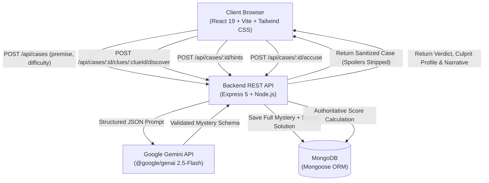

# 🕵️ AI Mystery Room — Autonomous Detective Game

[](https://vitejs.dev/)
[](https://react.dev/)
[](https://tailwindcss.com/)
[](https://nodejs.org/)
[](https://expressjs.com/)
[](https://www.mongodb.com/)
[](https://ai.google.dev/)

An interactive, procedural detective mystery web application where players investigate crimes generated live using **Google Gemini**. Players inspect crime scenes, interrogate suspect alibis, unlock forensic clues, manage hint penalties, and formally indict the culprit.

Designed and engineered following the formal [SPEC.md](./SPEC.md) blueprint.

---

## 🌟 Core Features

- 🧠 **Dynamic AI Generation**: Leverages Google Gemini (`gemini-2.5-flash` via `@google/genai`) with strict Zod schema validation to generate coherent mysteries with unique suspects, motive chains, and forensic evidence trails.
- 🛡️ **Anti-Cheat Server Architecture**: The culprit identity, solution narrative, and smoking-gun explanations are strictly hidden on the backend until an accusation is submitted. Undiscovered clues and locked hints are masked in API projections.
- 🎯 **Calibrated Difficulty Tiers**:
  | Tier | Suspects | Forensic Clues | Max Hints | Victory Bounty |
  | :--- | :---: | :---: | :---: | :---: |
  | **Easy** | 3 | 5 | 2 | 100 PTS |
  | **Medium** | 4 | 7 | 3 | 150 PTS |
  | **Hard** | 5 | 9 | 3 | 200 PTS |
- 🔍 **Interactive Evidence Inspection**: Discover clues dynamically to reveal forensic deductions and earn **+5 points** per clue.
- 💡 **Strategic Hint Economy**: Request sequential deductive hints when stuck, balanced against a **-10 points penalty** per hint.
- ⚖️ **Authoritative Server-Side Scoring**:
  $$\text{Final Score} = \max\Big(0, \text{Base Points} + (\text{Clues Discovered} \times 5) - (\text{Hints Used} \times 10)\Big)$$
- 🏆 **Dramatic Verdict & Solution Unveiling**: Correct accusations trigger victory celebrations with confetti, revealing the culprit profile, full crime timeline, and deductive smoking gun.

---

## 🏗️ System Architecture



---

## 📁 Repository Structure

```
Ai-Mystery Room/
├── SPEC.md                    # Comprehensive System Specification Document
├── README.md                  # Project Documentation & Run Guide
├── .gitignore                 # Root Git Ignore rules
│
├── client/                    # React + Vite Frontend SPA
│   ├── index.html             # HTML Shell with detective favicon
│   ├── package.json           # Dependencies: react-router-dom, axios, lucide-react, canvas-confetti
│   ├── vite.config.js         # Vite config with Tailwind v4 & /api proxy
│   └── src/
│       ├── api/caseApi.js     # Axios API service client
│       ├── components/        # Reusable UI Components
│       │   ├── Navbar.jsx
│       │   ├── Footer.jsx
│       │   ├── DifficultyBadge.jsx
│       │   ├── SuspectCard.jsx
│       │   ├── ClueCard.jsx
│       │   ├── HintModal.jsx
│       │   └── AccusationModal.jsx
│       ├── pages/             # Page Views
│       │   ├── HomePage.jsx
│       │   ├── CreateMysteryPage.jsx
│       │   ├── InvestigationPage.jsx
│       │   └── ResultPage.jsx
│       ├── App.jsx            # Application Router
│       ├── main.jsx           # React Root Entrypoint
│       └── index.css          # Tailwind CSS styles & detective themes
│
└── server/                    # Node.js + Express REST API Backend
    ├── package.json           # Dependencies: express, mongoose, @google/genai, zod, cors, dotenv
    ├── .env.example           # Environment template
    ├── test-api.js            # Automated verification test suite
    └── src/
        ├── server.js          # Express server entrypoint & health checks
        ├── config/db.js       # MongoDB Mongoose connection
        ├── models/            # Mongoose Schemas & anti-leak sanitizers
        │   └── MysteryCase.js
        ├── services/          # Gemini AI integration & fallback engines
        │   └── geminiService.js
        ├── controllers/       # Case business logic & scoring
        │   └── caseController.js
        └── routes/            # REST API endpoints
            └── caseRoutes.js
```

---

## 🚀 Quickstart & Local Setup

### Prerequisites
- [Node.js](https://nodejs.org/) (v18 or higher)
- [MongoDB](https://www.mongodb.com/) (Local instance or free [MongoDB Atlas](https://www.mongodb.com/atlas) cluster)
- Google Gemini API Key ([Google AI Studio](https://aistudio.google.com/))

### 1. Clone & Set Up Server

```bash
cd server
npm install
cp .env.example .env
```

Configure your `.env` file:
```env
PORT=5000
MONGODB_URI=mongodb://127.0.0.1:27017/ai-mystery-room
GEMINI_API_KEY=your_gemini_api_key_here
CLIENT_URL=http://localhost:5173
```

Start the backend server:
```bash
npm run dev
```

### 2. Set Up Client

In a separate terminal:
```bash
cd client
npm install
npm run dev
```

The application will be live at `http://localhost:5173`.

### 3. Run Backend Verification Tests

You can test the entire backend pipeline (case generation, clue discovery, hint penalties, anti-cheat sanitization, and accusation scoring):
```bash
node server/test-api.js
```

---

## 📡 REST API Reference

| Method | Endpoint | Description | Request Body |
| :--- | :--- | :--- | :--- |
| `GET` | `/api/health` | Service health & Gemini configuration status | None |
| `POST` | `/api/cases` | Generate case with Gemini and store in DB | `{ premise: string, difficulty: "Easy"\|"Medium"\|"Hard" }` |
| `GET` | `/api/cases` | List recent mystery case files | None |
| `GET` | `/api/cases/:id` | Retrieve active sanitized case file | None |
| `POST` | `/api/cases/:id/clues/:clueId/discover` | Inspect and discover forensic evidence (+5 pts) | None |
| `POST` | `/api/cases/:id/hints` | Unlock next sequential deductive hint (-10 pts) | None |
| `POST` | `/api/cases/:id/accuse` | Formally indict suspect, compute score, and unseal solution | `{ accusedSuspectId: string, motiveNotes?: string }` |
| `GET` | `/api/cases/:id/result` | Retrieve full completed case result & narrative reveal | None |

---

## 🚢 Deployment Guide

### Backend (Render / Railway / Fly.io)
1. Push repository to GitHub.
2. Create a new Web Service on **Render** or **Railway**.
3. Set the Root Directory to `server`.
4. Build Command: `npm install`
5. Start Command: `npm start`
6. Add Environment Variables:
   - `PORT`: `5000` (or host assigned)
   - `MONGODB_URI`: Your MongoDB Atlas connection URI (`mongodb+srv://<user>:<pwd>@cluster...`)
   - `GEMINI_API_KEY`: Your Gemini API Key from Google AI Studio
   - `CLIENT_URL`: Your deployed frontend URL (e.g. `https://ai-mystery-room.vercel.app`)

### Frontend (Vercel)
1. Import your GitHub repository into **Vercel**.
2. Set Root Directory to `client`.
3. Framework Preset: **Vite**.
4. Add Environment Variable:
   - `VITE_API_BASE_URL`: `https://your-backend-service.onrender.com/api`
5. Click **Deploy**.

---

## 📋 Acceptance Criteria Checklist

- [x] **Multi-Difficulty Generation**: Generates 3 suspects/5 clues/2 hints (Easy), 4/7/3 (Medium), and 5/9/3 (Hard).
- [x] **Deductive Consistency**: Validated via Zod; culprit is guaranteed in suspects list with clear motive/clue linkage.
- [x] **Zero-Leak Security**: Culprit identity and full solution are concealed on backend until formal accusation.
- [x] **Interactive Clue Discovery**: Real-time evidence inspection awards +5 points and updates clue progress.
- [x] **Hint Economy**: Sequential hint unlocks with -10 point penalty and confirmation dialog.
- [x] **Authoritative Scoring**: Backend calculates net score (Base + Clues - Hints) with a minimum floor of 0.
- [x] **Case Results & Narrative Reveal**: Displays celebratory verdict, score audit table, culprit profile, and full crime timeline.
- [x] **Responsive Detective Noir UI**: Atmospheric design built with Tailwind CSS, Lucide icons, and canvas-confetti.
