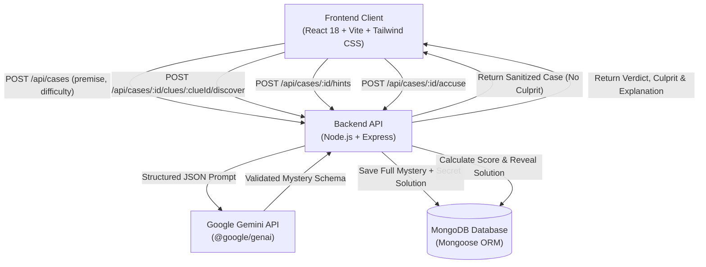
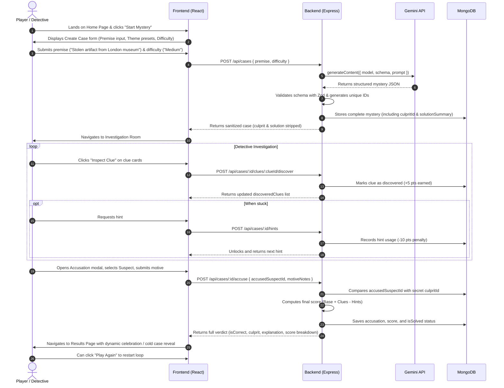

# AI Mystery Room — Technical Specification (SPEC.md)

## 1. Project Overview & Problem Statement

### 1.1 Overview
**AI Mystery Room** is an interactive, AI-driven detective web application where players create, investigate, and solve procedurally generated mysteries. Powered by Google Gemini and built on the MERN stack (React, Vite, Tailwind CSS, Node.js, Express, MongoDB/Mongoose), the application generates immersive murder mysteries, locked-room puzzles, and heist scenarios tailored to player-chosen premises and difficulty tiers.

### 1.2 Problem Statement
Traditional digital mystery games rely on static, pre-written storylines with zero replay value once solved. Conversely, naive generative AI implementations tend to hallucinate plot holes, leak the culprit prematurely to the client-side browser, or lack consistent clue-to-suspect deductive paths. 

AI Mystery Room solves these issues by:
1. Enforcing strict, validated structured JSON outputs from Google Gemini.
2. Protecting case integrity with a zero-leak server-side architecture (culprit and solution remain isolated on the backend until an accusation is formally recorded).
3. Providing an engaging, atmospheric detective dashboard with dynamic clue discovery, progressive hint unlocks, and backend-calculated scoring.

### 1.3 Target Users & Expected Experience
- **Target Users**: Puzzle enthusiasts, detective fiction fans, casual gamers, and CCBP/AI reviewers looking for an engaging mystery experience.
- **Expected Experience**: 
  - Cinematic, moody detective noir / modern crime investigator UI.
  - Smooth 3-step loop: **Generate Mystery** $\rightarrow$ **Investigate & Discover Clues** $\rightarrow$ **Accuse & Reveal Verdict**.
  - Immediate responsive feedback, clear deductive trails, and fair scoring with no spoilers.

---

## 2. System Architecture & Tech Stack



### 2.1 Technology Stack
- **Frontend**:
  - React 18 (SPA)
  - Vite (Build Tool & Dev Server)
  - Tailwind CSS + Lucide Icons (Styling & Detective Theme)
  - React Router DOM v6 (Routing)
  - Axios (HTTP Client)
  - Canvas Confetti (Victory feedback)
- **Backend**:
  - Node.js (v20+) & Express.js (REST API Server)
  - `@google/genai` (Official Google Gen AI SDK with `gemini-2.5-flash` / `gemini-1.5-flash`)
  - Mongoose 8+ (MongoDB ODM)
  - Zod (Runtime validation of AI responses and API payloads)
  - CORS, Dotenv, Morgan (Middleware)
- **Database**:
  - MongoDB (Atlas in production / local MongoDB or Memory Server fallback)
- **Hosting / Deployment**:
  - Frontend: Vercel / Netlify
  - Backend: Render / Railway / Node host

---

## 3. User Flow



---

## 4. UI & Page Specifications

### 4.1 Atmospheric Detective Noir Design Theme
- **Color Palette**:
  - Background: Deep slate / obsidian (`#0b0f19`, `#0f172a`, `#1e293b`)
  - Accent / Primary: Golden Amber / Brass (`#f59e0b`, `#d97706`, `#fbbf24`)
  - Crime / Evidence Accent: Blood Crimson / Neon Coral (`#ef4444`, `#dc2626`)
  - Text: Clean slate whites and muted amber grays (`#f8fafc`, `#94a3b8`)
- **Typography & Details**:
  - Clean monospace evidence tags (`font-mono`)
  - Classified dossier badges, stamped seals ("TOP SECRET", "SOLVED", "EVIDENCE")
  - Smooth micro-interactions, skeleton loaders, and crime scene tape accents

### 4.2 Page Breakdown

#### Page 1: Home Page (`/`)
- **Header**: Case banner, project branding ("AI Mystery Room: Case Files"), quick badge for Gemini 2.5.
- **Hero Section**: Catchy tagline ("Every Mystery is Generated Live. Can You Crack the Case?"), animated magnifying glass / crime dossier visual.
- **Feature Cards**:
  - *Generative AI Storytelling*: Infinite replayability powered by Gemini.
  - *Zero Spoilers*: Server-side solution lockdown.
  - *Deductive Scoring*: Reward thorough investigation, penalize reliance on hints.
- **How to Play Guide**: 4-step interactive walkthrough cards.
- **Call to Action**: High-contrast "Open A New Case" button navigating to `/create`.

#### Page 2: Create Mystery Page (`/create`)
- **Premise Input**:
  - Textarea with placeholder: *"e.g. A wealthy tech CEO is poisoned during an exclusive island launch party..."*
  - **Quick Premise Presets**: 4 clickable quick-fill chips:
    - 🏛️ *The Midnight Museum Heist*
    - ❄️ *Express Train in the Blizzard*
    - 🏰 *The Cyberpunk Penthouse Murder*
    - 🎭 *Curtains Down at the Grand Opera*
- **Difficulty Selector**:
  - 3 interactive cards with badges:
    - **Easy**: 3 Suspects, 5 Clues, 2 Hints. Base Reward: 100 pts.
    - **Medium**: 4 Suspects, 7 Clues, 3 Hints. Base Reward: 150 pts. (Recommended default)
    - **Hard**: 5 Suspects, 9 Clues, 3 Hints. Base Reward: 200 pts.
- **Submit Button**: "Generate Case Dossier" with loading spinner and cycling suspenseful loading messages (*"Consulting Scotland Yard...", "Analyzing forensic trace evidence...", "Interrogating witnesses..."*).

#### Page 3: Investigation Room (`/case/:id`)
- **Header Bar**:
  - Case Title, Difficulty Badge, Current Progress Bar (% clues discovered).
  - Status Indicators: Clues Found (`X/Y`), Hints Remaining (`A/B`), Estimated Score.
  - "Make Accusation" persistent CTA button.
- **Story Dossier Accordion/Card**:
  - The inciting incident narrative, setting the scene and timestamp.
- **Suspects Dossier Grid**:
  - Cards displaying suspect name, occupation/role, relationship to victim, initial statement, and alibi.
  - Visual avatar with crime file silhouette.
- **Clues & Forensic Evidence Grid**:
  - Undiscovered clues: Card showing clue category (Physical, Testimonial, Document, Digital) and an "Inspect Evidence" button.
  - Discovered clues: Expands with full description, forensic relevance, and discovery badge (+5 pts).
- **Hints Drawer / Section**:
  - Display available hints unlocked.
  - "Request Hint (-10 pts)" button with a safety modal (*"Are you sure? This will deduct 10 points from your final score"*).
- **Accusation Action Button**: Floats or anchors at bottom to transition to accusation.

#### Page 4: Accusation Modal / Page (`/case/:id/accuse`)
- **Suspect Picker**: Visual radio selector of all suspect profiles with their photos and alibis.
- **Deductive Motive Textarea**: Optional/required player notes explaining why they chose this suspect and which clue sealed their fate.
- **Warning Notice**: "Once you submit your accusation, the case file will be sealed and the verdict will be final."
- **Submit Button**: "Formally Indict Suspect".

#### Page 5: Case Results Page (`/case/:id/result`)
- **Verdict Banner**:
  - **GUILTY AS CHARGED (Success)**: Confetti animation, golden detective badge, high score celebration.
  - **WRONGFUL ACCUSATION / CASE COLD (Failure)**: Red siren theme, criminal escaped banner.
- **Score Breakdown Table**:
  - Base difficulty points (e.g., +150 for Medium) or 0 if wrong.
  - Clue Discovery bonus ($N \times +5$ pts).
  - Hint penalty ($M \times -10$ pts).
  - **Final Net Score** ($\ge 0$).
- **The Unveiling (Truth Revealed)**:
  - True Culprit Identity and their photograph/profile.
  - The Culprit's Motive and Opportunity.
  - **Comprehensive Solution Narrative**: Step-by-step breakdown of how the crime unfolded and how the discovered clues exposed the culprit.
- **Actions**:
  - "Investigate Another Mystery" (routes to `/create`).
  - "Review Full Case Dossier" (read discovered clues alongside the solution).

---

## 5. Backend & Database Design

### 5.1 MongoDB Mongoose Schema (`MysteryCase`)

```javascript
const SuspectSchema = new mongoose.Schema({
  id: { type: String, required: true },
  name: { type: String, required: true },
  role: { type: String, required: true },
  bio: { type: String, required: true },
  alibi: { type: String, required: true },
  avatarUrl: { type: String, default: '' }
});

const ClueSchema = new mongoose.Schema({
  id: { type: String, required: true },
  title: { type: String, required: true },
  category: { 
    type: String, 
    enum: ['Physical', 'Testimonial', 'Document', 'Digital', 'Forensic'],
    default: 'Physical'
  },
  description: { type: String, required: true },
  significance: { type: String, required: true },
  isDiscovered: { type: Boolean, default: false },
  discoveredAt: { type: Date, default: null }
});

const HintSchema = new mongoose.Schema({
  id: { type: String, required: true },
  order: { type: Number, required: true },
  text: { type: String, required: true },
  isUsed: { type: Boolean, default: false },
  usedAt: { type: Date, default: null }
});

const MysteryCaseSchema = new mongoose.Schema({
  title: { type: String, required: true },
  premise: { type: String, required: true },
  difficulty: { 
    type: String, 
    enum: ['Easy', 'Medium', 'Hard'], 
    required: true 
  },
  story: { type: String, required: true },
  crimeScene: { type: String, required: true },
  victim: {
    name: { type: String, required: true },
    description: { type: String, required: true }
  },
  suspects: [SuspectSchema],
  clues: [ClueSchema],
  hints: [HintSchema],

  // SECURITY SENSITIVE FIELDS: Stored safely in DB, excluded from initial player queries
  culpritId: { type: String, required: true },
  solutionSummary: { type: String, required: true },
  howCluesRevealCulprit: { type: String, required: true },

  // GAMEPLAY STATE
  status: { 
    type: String, 
    enum: ['investigating', 'completed'], 
    default: 'investigating' 
  },
  accusation: {
    accusedSuspectId: { type: String, default: null },
    accusedSuspectName: { type: String, default: null },
    motiveNotes: { type: String, default: '' },
    isCorrect: { type: Boolean, default: null },
    accusedAt: { type: Date, default: null }
  },
  scoring: {
    basePoints: { type: Number, default: 0 },
    cluesDiscoveredCount: { type: Number, default: 0 },
    cluesBonus: { type: Number, default: 0 },
    hintsUsedCount: { type: Number, default: 0 },
    hintsPenalty: { type: Number, default: 0 },
    finalScore: { type: Number, default: 0 }
  }
}, { timestamps: true });
```

### 5.2 Server-Side Data Sanitization (Anti-Cheat Security)

To satisfy the strict security requirement that the culprit and solution are never exposed in network payloads until accusation:
- A custom serialization method `case.toSanitizedJSON()` is executed on all `GET /api/cases/:id` and clue/hint updates.
- In sanitized mode:
  - `culpritId`, `solutionSummary`, and `howCluesRevealCulprit` are **completely stripped**.
  - Clues that have `isDiscovered === false` return only `id`, `category`, and `title`, concealing the full forensic `description` and `significance` until the player clicks discover.
  - Hints that have `isUsed === false` conceal their text, returning only hint counts and availability.

### 5.3 REST API Endpoints Specification

| Method | Endpoint | Description | Request Body | Response (Key Fields) |
| :--- | :--- | :--- | :--- | :--- |
| `POST` | `/api/cases` | Generate case with Gemini, save to DB | `{ premise: string, difficulty: "Easy"\|"Medium"\|"Hard" }` | `{ success: true, case: SanitizedCase }` |
| `GET` | `/api/cases/:id` | Retrieve active case file | None | `{ success: true, case: SanitizedCase }` |
| `POST` | `/api/cases/:id/clues/:clueId/discover` | Inspect and discover a clue | None | `{ success: true, clue: DiscoveredClue, cluesFound: number }` |
| `POST` | `/api/cases/:id/hints` | Unlock next available hint | None | `{ success: true, hint: UnlockedHint, hintsRemaining: number }` |
| `POST` | `/api/cases/:id/accuse` | Submit accusation and calculate score | `{ accusedSuspectId: string, motiveNotes?: string }` | `{ success: true, result: CaseResult }` |
| `GET` | `/api/cases/:id/result` | Retrieve full completed case & reveal | None (Blocked if status !== 'completed') | `{ success: true, result: FullCaseResult }` |
| `GET` | `/api/health` | Health and connectivity check | None | `{ status: "ok", timestamp: ISOString }` |

---

## 6. AI Behavior & Structured Gemini Generation

### 6.1 Difficulty Parameters Matrix

| Difficulty | Suspects Count | Clues Count | Max Hints | Base Correct Score | Clue Reward | Hint Penalty | Min Score |
| :--- | :---: | :---: | :---: | :---: | :---: | :---: | :---: |
| **Easy** | 3 | 5 | 2 | 100 pts | +5 pts | -10 pts | 0 |
| **Medium** | 4 | 7 | 3 | 150 pts | +5 pts | -10 pts | 0 |
| **Hard** | 5 | 9 | 3 | 200 pts | +5 pts | -10 pts | 0 |

### 6.2 Prompt Engineering Strategy
- **Role**: Master Mystery Game Designer and Agatha Christie / Arthur Conan Doyle level logician.
- **Deductive Consistency Rules**:
  1. The culprit MUST have a clear motive, opportunity, and means.
  2. Exactly one suspect is the culprit (`culpritId` must match one of the generated suspect IDs).
  3. Every clue must contribute logically to the narrative (some establish alibis of innocents, at least 2 clues directly incriminate the culprit when pieced together, 1-2 innocent red herrings for Hard).
  4. Hints must provide gentle deductive nudges without explicitly naming the culprit.
- **Enforcement**: Utilizes `@google/genai` with `responseMimeType: 'application/json'` and `responseSchema` or Zod parsing to guarantee zero formatting failures.

### 6.3 Zod Validation Schema

```javascript
import { z } from 'zod';

export const GeminiMysterySchema = z.object({
  title: z.string().min(3),
  story: z.string().min(50),
  crimeScene: z.string().min(20),
  victim: z.object({
    name: z.string().min(2),
    description: z.string().min(10)
  }),
  suspects: z.array(z.object({
    id: z.string(),
    name: z.string(),
    role: z.string(),
    bio: z.string(),
    alibi: z.string()
  })),
  clues: z.array(z.object({
    id: z.string(),
    title: z.string(),
    category: z.enum(['Physical', 'Testimonial', 'Document', 'Digital', 'Forensic']),
    description: z.string(),
    significance: z.string()
  })),
  hints: z.array(z.object({
    id: z.string(),
    order: z.number(),
    text: z.string()
  })),
  culpritId: z.string(),
  solutionSummary: z.string().min(40),
  howCluesRevealCulprit: z.string().min(40)
});
```

---

## 7. Scoring System Formula

All scores are calculated authoritatively on the backend upon accusation submission:

$$\text{Final Score} = \max\Big(0, \text{Base Points} + (\text{Clues Discovered} \times 5) - (\text{Hints Used} \times 10)\Big)$$

Where:
- If accusation is **CORRECT**:
  - Easy: $\text{Base Points} = 100$
  - Medium: $\text{Base Points} = 150$
  - Hard: $\text{Base Points} = 200$
- If accusation is **INCORRECT**:
  - $\text{Base Points} = 0$
  - (Bonus points from clues still count, but hints still deduct, floored at 0).

---

## 8. Acceptance Criteria Checklist

- [ ] **AC-1: Multi-Difficulty Generation**: Generates valid cases with 3 suspects/5 clues/2 hints (Easy), 4/7/3 (Medium), and 5/9/3 (Hard).
- [ ] **AC-2: Deductive Integrity**: AI output is validated by Zod. Culprit ID matches an existing suspect, and clues link to the solution.
- [ ] **AC-3: Zero Premature Spoiler Leak**: Culprit and solution fields cannot be found in initial network responses, Redux/state trees, or DOM elements before accusation.
- [ ] **AC-4: Interactive Clue Discovery**: Players can reveal clues one by one, updating discovered count and earning +5 pts per clue.
- [ ] **AC-5: Hint Penalty Mechanism**: Players can request sequential hints up to the difficulty limit, incurring -10 pts per hint with a confirmation dialog.
- [ ] **AC-6: Authoritative Backend Accusation**: Player submits accusation; server evaluates correctness, stores results, and computes net score with minimum floor of 0.
- [ ] **AC-7: Complete Results Experience**: Displays verdict, final score breakdown, culprit identity, and comprehensive narrative explanation.
- [ ] **AC-8: Full Responsive UI**: Works cleanly on desktop, tablet, and mobile screens with dark atmospheric styling and loading indicators.
- [ ] **AC-9: Error Handling**: Graceful fallback if Gemini API is delayed or quota limited, with user-friendly error banners.
- [ ] **AC-10: Live Production Deployment**: Backend and frontend deployed and functional with environment variables secured.

